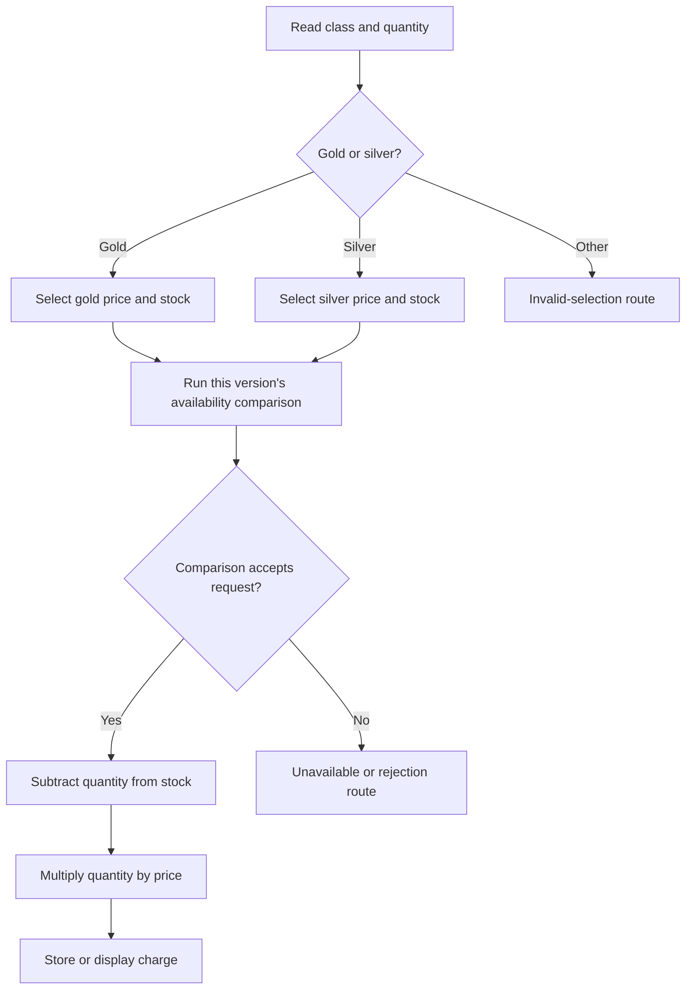
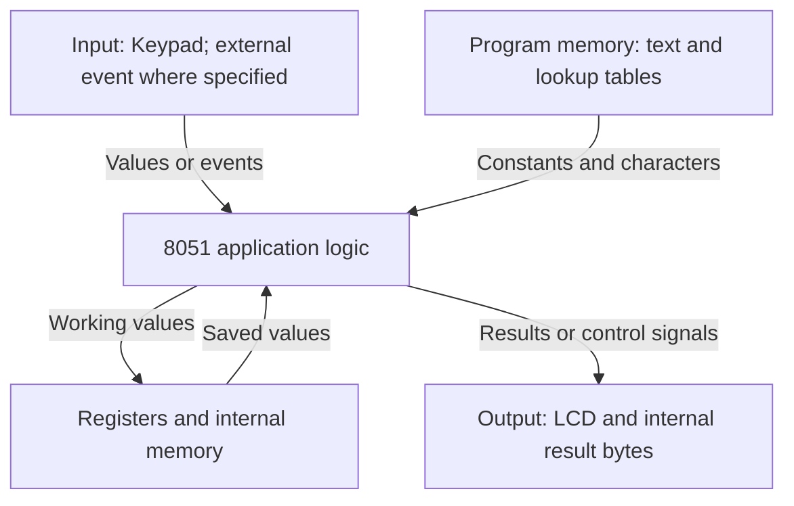

# Gold and Silver Ticket Booking

[Repository overview](../../README.md) · [Compare implementations](../README.md)

Select gold or silver tickets, calculate the charge, and update the stored number of tickets.

**Implementation:** Keypad Booking Stock Check

**Input:** keypad.  
**Output:** LCD and internal result bytes.

## Inputs and results

| Parameter | Description |
| --- | --- |
| Input | Ticket class, requested quantity, and available stock |
| Output | Total price and remaining stock, or an unavailable message |

## Worked example

With 9 gold tickets in stock, price 5, and a request for 2: charge 10 and remaining stock 7.

### Calculation details

Use the gold calculation with stock 9, unit price 5 and quantity 2. On the successful path the remaining stock is 9 − 2 = 7 and the charge is 2 × 5 = 10. A debugger shows 0AH in the accumulator immediately after MUL AB. Check the stock comparison separately with a request above 9.

## Program operation

### Functional flowchart

[Detailed control flow](Control%20Flow.md)

### Simplified block diagram

**Port registers:** `P0`, `P0.4`, `P0.6`, `P1`, `P1.2`, `P1.3`, `P1.4`, `P1.5`, `P1.6`, `P1.7`.

[Assembly source](source.txt)
