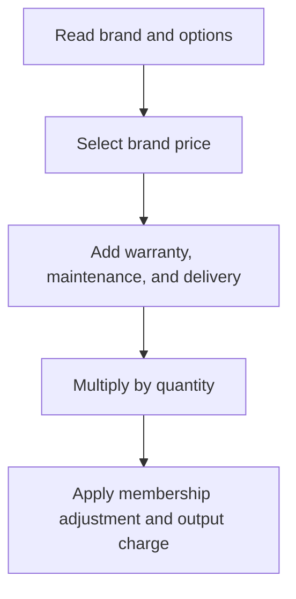
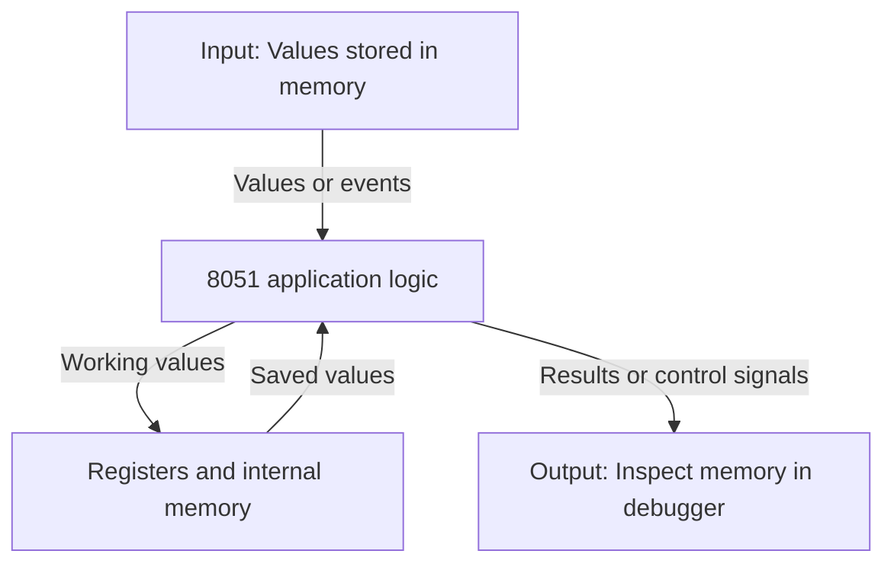

# Television Order Pricing

[Repository overview](../../README.md) · [Compare implementations](../README.md)

Build a television order price from a brand and optional services.

**Implementation:** Memory Brand Service Pricing

**Input:** values stored in memory.  
**Output:** inspect memory in debugger.

## Inputs and results

| Parameter | Description |
| --- | --- |
| Input | Brand, warranty, maintenance, delivery, quantity, and membership |
| Output | Total order charge |

## Worked example

For brand 2: 55 + 2 + 3 + 3 = 63 each; two cost 126; subtracting 17 gives 109.

### Calculation details

Select brand 2, warranty 1, maintenance 1, delivery 1, quantity 2 and membership 1. Follow the calculation with these numeric choices in the option bytes. The base price of 55 gains 2 for warranty, 3 for maintenance and 3 for delivery. Multiplying 63 by 2 gives 126. The brand-2 membership adjustment subtracts 17, leaving 109 (6DH) in the cost byte at 36H.

## Program operation

1. Read brand and options.
2. Select brand price.
3. Add warranty, maintenance, and delivery.
4. Multiply by quantity.
5. Apply membership adjustment and output charge.

### Functional flowchart

[Detailed control flow](Control%20Flow.md)

### Simplified block diagram

Results are available in memory without a display.

[Assembly source](source.asm)
